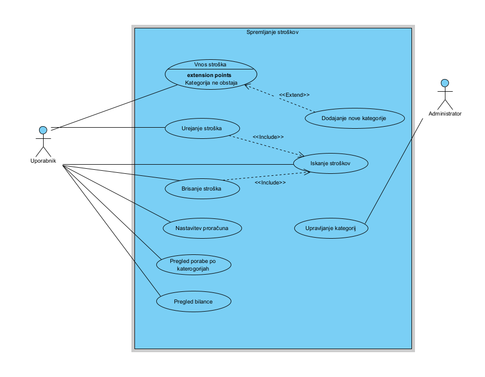
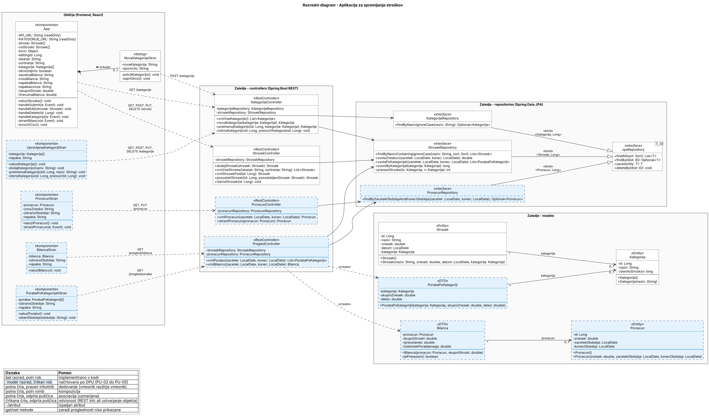

# Aplikacija za spremljanje stroškov (Expense Tracker)

## Člani skupine
- Klemen Skuhala
- Jan Pečnik
- Semir Slamar

## Vizija projekta
### Opis rešitve
Aplikacija "Spremljanje stroškov" je spletni sistem, namenjen preprostemu in učinkovitemu upravljanju osebnih financ. Uporabnikom omogoča sistematično beleženje vsakodnevnih izdatkov in dohodkov ter spremljanje porabe po različnih kategorijah. Cilj aplikacije je povečati finančno pismenost uporabnikov in jim pomagati pri optimizaciji osebnih proračunov s pregledno vizualizacijo njihovih finančnih tokov.

### Ključne funkcionalnosti
- Beleženje, branje, urejanje in brisanje (CRUD) finančnih transakcij.
- Kategorizacija stroškov (npr. hrana, prevoz, zabava) po meri uporabnika.
- Dinamično iskanje po nazivu in razvrščanje podatkov po višini zneska.
- Sprotni izračun in prikaz trenutne finančne bilance.

### Obseg rešitve in morebitne omejitve
Aplikacija v trenutni fazi deluje kot samostojna rešitev brez neposredne integracije z bančnimi API-ji v živo, zato je vnos transakcij ročen. Podpira beleženje zneskov v enotni valuti in zaenkrat ne vključuje večuporabniških družinskih računov ter zahtevnejših finančnih predvidevanj (forecasting).

## Besednjak
- **Transakcija:** Posamezen dogodek priliva (dohodek) ali odliva (strošek) finančnih sredstev z določenim zneskom in datumom.
- **Bilanca:** Trenutno stanje razpoložljivih finančnih sredstev uporabnika, izračunano kot razlika med vsemi prihodki in odhodki.
- **Kategorija izdatka:** Tematska skupina, v katero uporabnik uvrsti posamezno transakcijo za lažjo analizo porabe.
- **Proračun (Budget):** Ciljna finančna omejitev, ki si jo uporabnik določi za posamezno kategorijo ali časovno obdobje.
- **Mesečni limit:** Opozorilna vrednost, pri kateri sistem uporabnika obvesti, da se bliža prekoračitvi načrtovanih izdatkov.

## Diagram primerov uporabe (UCD)



## Razredni diagram



*Izvorna koda diagrama (PlantUML): [razredni_diagram.puml](razredni_diagram.puml). Diagram je v polni velikosti viden s klikom na sliko.*

Diagram prikazuje celotno zasnovo aplikacije: tisto, kar je že implementirano (bele barve), in funkcionalnosti iz DPU, ki še niso implementirane (**PU-02 do PU-05**, modro s črtkanim robom).

### Vloga in namen razredov

| Sloj | Razred | Vloga in namen |
|---|---|---|
| Obličje | `App` | Glavna React komponenta. Hrani stanje (seznam stroškov, obrazec, iskanje, razvrščanje, začetna bilanca) in kliče REST API zaledja. |
| Obličje | `NovaKategorijaOkno` | Pogovorno okno za vnos nove kategorije med vnosom stroška (PU-01). Obstaja samo kot del `App` (kompozicija). |
| Obličje | `UpravljanjeKategorijStran` | Stran administratorja za dodajanje, preimenovanje in brisanje kategorij (PU-02). |
| Obličje | `ProracunStran` | Stran za nastavitev proračuna za izbrano obdobje (PU-03). |
| Obličje | `PorabaPoKategorijahStran` | Stran s tabelo porabe po kategorijah (PU-04). |
| Obličje | `BilancaStran` | Stran s proračunom, porabo in preostankom (PU-05). |
| Controllers | `StrosekController` | REST API `/stroski`: CRUD nad stroški, iskanje po nazivu in razvrščanje po znesku. |
| Controllers | `KategorijaController` | REST API `/kategorije`: seznam kategorij, nova kategorija (preverjanje imena, brez podvajanja), preimenovanje in brisanje s prenosom stroškov. |
| Controllers | `ProracunController` | REST API `/proracun`: branje in shranjevanje proračuna za obdobje. |
| Controllers | `PregledController` | REST API `/pregled`: samo branje, izračun porabe po kategorijah in bilance. |
| Repositories | `JpaRepository<T, ID>` | Spring Data vmesnik z osnovnimi operacijami nad bazo. Vsi repozitoriji ga razširjajo (dedovanje). |
| Repositories | `StrosekRepository`, `KategorijaRepository`, `ProracunRepository` | Dostop do podatkov. Poleg podedovanih operacij vsebujejo poizvedbe (iskanje, vsote, štetje). |
| Models | `Strosek` | Entiteta: posamezen strošek (naziv, znesek, datum, kategorija). |
| Models | `Kategorija` | Entiteta: kategorija stroškov. Število stroškov v kategoriji je izpeljan atribut. |
| Models | `Proracun` | Entiteta: znesek, ki si ga uporabnik dovoli porabiti v obdobju. |
| Models | `Bilanca` | DTO: rezultat izračuna bilance (proračun, skupni stroški, preostanek, odstotek). |
| Models | `PorabaPoKategoriji` | DTO: ena vrstica pregleda porabe (kategorija, skupni znesek, delež). |

### Ključne metode po funkcionalnostih

| Funkcionalnost | Ključne metode | Naloga |
|---|---|---|
| Vnos, urejanje, brisanje stroška | `App.handleSubmit`, `handleEdit`, `handleDelete` → `StrosekController.dodajStrosek`, `posodobiStrosek`, `izbrisiStrosek` | Obličje pošlje zahtevo (POST, PUT, DELETE), kontroler pa spremembo shrani prek `JpaRepository.save` oziroma `deleteById`. |
| Iskanje in razvrščanje | `App.naloziStroske` → `StrosekController.vrniVseStroske` → `StrosekRepository.findByNazivContainingIgnoreCase` | Vrne stroške, ki ustrezajo iskanemu nizu, razvrščene po znesku. Po vnosu, urejanju in brisanju se kliče znova (`<<include>>` iz DPU). |
| Dodajanje nove kategorije (`<<extend>>`) | `App.handleKategorija`, `NovaKategorijaOkno.potrdiKategorijo` → `KategorijaController.novaKategorija` → `KategorijaRepository.findByNazivIgnoreCase` | Odpre okno, preveri ime (neprazno, največ 30 znakov), ne podvaja kategorij (velike črke se ne upoštevajo) in jo shrani. |
| Upravljanje kategorij (PU-02) | `UpravljanjeKategorijStran.preimenujKategorijo`, `izbrisiKategorijo` → `KategorijaController.preimenujKategorijo`, `izbrisiKategorijo` | Preimenuje ali izbriše kategorijo. Pri brisanju kategorije s stroški jih prek `StrosekRepository.countByKategorija` in `prenesiStroske` prenese v drugo kategorijo. |
| Nastavitev proračuna (PU-03) | `ProracunStran.shraniProracun` → `ProracunController.shraniProracun` → `ProracunRepository.findByZacetekObdobjaAndKonecObdobja` | Preveri, da je znesek pozitiven. Če proračun za obdobje že obstaja, ga prepiše, sicer ustvari novega. |
| Pregled porabe po kategorijah (PU-04) | `PorabaPoKategorijahStran.naloziPorabo` → `PregledController.vrniPorabo` → `StrosekRepository.vsotaPoKategorijah` | Sešteje stroške po kategorijah v obdobju in vrne `PorabaPoKategoriji` (znesek in delež). |
| Pregled bilance (PU-05) | `BilancaStran.naloziBilanco` → `PregledController.vrniBilanco` → `StrosekRepository.vsotaZneskov`, `Bilanca.jePresezen` | Prebere proračun, sešteje stroške, izračuna preostanek in odstotek ter ugotovi, ali je proračun presežen. |
| Začetna bilanca (US-SEM-01) | `App.shraniBilanco`, izpeljan atribut `trenutnaBilanca` | Preveri vnos, shrani začetno bilanco v `localStorage` in izračuna trenutno bilanco (začetna minus vsi stroški). |
| Izvoz v CSV (US-KLE-01) | `App.izvoziVCsv` | Prikazani seznam stroškov pretvori v datoteko `stroski.csv` ali pokaže opozorilo, če je seznam prazen. |

### Opombe k diagramu

- **Povezave:** polna črta s praznim trikotnikom je dedovanje (repozitoriji razširjajo `JpaRepository`, oznaka `<<bind>>` pove konkretna parametra), polna črta s polnim rombom je kompozicija, polna črta z odprto puščico je asociacija, črtkana črta z odprto puščico pa odvisnost (REST klic obličja na zaledje ali ustvarjanje objekta).
- **Polja tipa razreda** (npr. repozitoriji v kontrolerjih, `Strosek.kategorija`) so prikazana kot atribut in hkrati kot asociacija z množičnostjo.
- **Spremembe glede na trenutno kodo:** za PU-02 do PU-05 mora `Strosek` dobiti atribut `datum`, polje `kategorija` pa se spremeni iz `String` v povezavo na `Kategorija` (strošek brez kategorije je dovoljen, zato množičnost `0..1`). Tako sta mogoča štetje in prenos stroškov med kategorijami ter filtriranje po obdobju.
- **React komponente** so funkcijske, zato so v diagramu prikazane kot razredi s stereotipom `<<komponenta>>`. `NovaKategorijaOkno` je v kodi element `<dialog>` znotraj `App.jsx`, tu pa je izločen kot logični del.
- Zaradi preglednosti niso prikazane `get`/`set` metode in zagonski razred `StroskiApplication`.


---

## O projektu
Aplikacija je zasnovana po strogo ločeni arhitekturi zaledja (backend) in obličja (frontend). Glavni cilj projekta je uporabnikom omogočiti boljši pregled nad financami in načrtovanjem proračuna. 

## Uporabljene tehnologije
**Zaledje (Backend):**
- **Java** (JDK 17)
- **Spring Boot** (ogrodje za REST API)
- **Spring Data JPA** (za ORM in komunikacijo z bazo)
- **PostgreSQL** (relacijska podatkovna baza)
- **Swagger / springdoc-openapi** (v 2.2.0 - za dokumentacijo API-ja)

**Obličje (Frontend):**
- **React** (uporabniški vmesnik)
- **Vite** (gradbeno orodje in lokalni strežnik)
- **Node.js / npm** (paketni upravljalnik)

**Infrastruktura:**
- **Docker** (v 24.0) & **Docker Compose** (v 2.0) (za kontejnerizacijo podatkovne baze)

## Struktura projekta
Projekt je strogo ločen na obličje in zaledje:

```text
📦 Vaja-Stroski (Glavna mapa)
 ┣ 📂 backend/               # Zaledni sistem (Spring Boot)
 ┃ ┣ 📂 src/main/java/...    # Izvorna koda (modeli, repozitoriji, kontrolerji)
 ┃ ┣ 📂 src/main/resources/  # Konfiguracije (application.properties)
 ┃ ┣ 📜 pom.xml              # Maven odvisnosti in nastavitve
 ┃ ┗ 📜 docker-compose.yml   # Skripta za zagon PostgreSQL baze
 ┣ 📂 frontend/              # Obličje (React)
 ┃ ┣ 📂 src/                 # Komponente in logika (App.jsx)
 ┃ ┣ 📜 package.json         # Seznam npm paketov in skript
 ┃ ┗ 📜 vite.config.js       # Vite konfiguracija
 ┗ 📜 README.md              # Dokumentacija projekta
```
 # Navodila za nameščanje in zagon
 Za uspešen zagon aplikacije moramo imeti nameščene naslednje predpostavke:
 
 **Java Development Kit (JDK) (version 17+)**
 **Node.js in npm**
 **Docker in Docker Desktop**

 # 1.Zagon podatkovne baze
 ## Odprite terminal in se pomaknite v mapo backend:
 cd backend
 ## Zaženite Docker vsebnik s PostgreSQL bazo:
 docker compose up -d
 (Baza bo samodejno ustvarjena s podatki iz docker-compose.yml, zaledje pa se bo nanjo povezalo preko nastavitev v application.properties).

 # 2. Zagon backenda (zaledja)
1. Prepričajte se, da ste v mapi **backend**.

2. Aplikacijo lahko zaženete preko vašega razvojnega okolja (npr. zagon StroskiApplication.java v IntelliJ IDEA / VS Code) ali preko Maven ukaza v terminalu.

3. Zaledje bo uspešno zagnano na: http://localhost:8080

4. Swagger dokumentacija bo na voljo na: http://localhost:8080/swagger-ui/index.html

# 3. Zagon frontenda (obličja)
1. Odprite nov terminal in se pomaknite v mapo frontend:
**cd frontend**

2. Namestite potrebne knjižnice:
**npm install**

3. Zaženite lokalni strežnik:
**npm run dev**

4. Aplikacija bo dosegljiva v brskalniku na: http://localhost:5173

# Navodila za razvijalce
## Delo z repozitorijem (GitHub Workflow)
Za prispevanje k projektu sledite standardnemu Git poteku dela:

1. Naredite klon repozitorija: git clone <povezava-do-repozitorija>

2. Za vsako novo funkcionalnost ustvarite novo vejo: git checkout -b feature/ime-funkcionalnosti

3. Redno potrjujte spremembe z jasnimi sporočili: git commit -m "Dodano iskanje po nazivu stroška"

4. Potisnite vejo na GitHub: git push origin feature/ime-funkcionalnosti

5. Ustvarite Pull Request (PR) in počakajte na pregled kode pred združevanjem v glavno (main) vejo.

## Standardi kodiranja

1. Spremenljivke in metode: Poimenovanja naj bodo opisna in v camelCase formatu (npr. naloziStroske).

2. Komentarji: Koda naj bo komentirana tam, kjer kompleksnost logike to zahteva, še posebej pri komunikaciji med FE in BE komponentami.

3. Arhitektura: Strogo ohranjajte ločenost! Frontend koda ne sme vsebovati nobenih direktnih klicev v podatkovno bazo, zaledje pa ne sme generirati HTML kode (vrača naj izključno JSON).

## Uporabniške zgodbe

Podrobnosti so v datoteki [docs/user-stories.md](docs/user-stories.md).